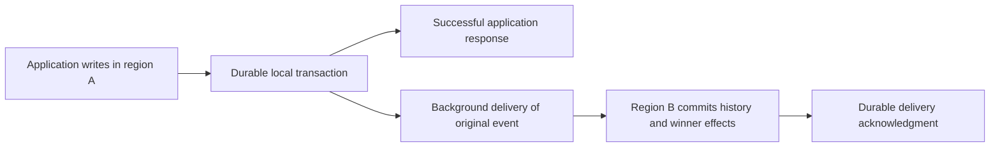

# Operating multi-region replication

Last updated: 2026-10-10

Status: experimental. This guide describes the current asynchronous implementation;
deployment capacity and recovery time must be qualified for your workload.

Aux-storage replicates selected DynamoDB-compatible tables between regions. Each active
replica can accept item writes, and replicas exchange those writes asynchronously.
Conflicts converge to one whole-item winner. This resembles DynamoDB Global Tables with
multi-Region eventual consistency (MREC). Aux-storage has no multi-Region strong
consistency (MRSC) mode.

Replication is opt-in. Ordinary aux-fn and aux-analytics consumers keep their existing
configuration and APIs. Ordinary-only deployments start no replication services. SQS,
SNS, queues, pubsub and unrelated streams remain regional; enabling a global table does
not replicate those services.

## What a successful write means

A successful item write means the originating region durably committed the item effects
and the original replication event together. Delivery to other regions happens afterward.
An unreachable peer does not add a remote acknowledgment requirement to that response.



The native transaction also includes the applicable local indexes, TTL metadata, streams
and recovery records. A failed condition produces no accepted replication event. Accepted
same-image writes and writes that later lose a conflict remain part of canonical history.

| Question | Operational answer |
| --- | --- |
| Does a successful write mean another region already has it? | No. Delivery is asynchronous. |
| Does a strongly consistent read include every region's latest write? | No. It observes the local committed state; an undelivered remote write can be missing. |
| Can two regions both pass the same condition? | Yes. Each condition checks its regional state. |
| Is a transaction atomic? | Within its originating native database. Remote replicas can observe its items separately. |
| Can a transaction mix ordinary and global tables? | Yes, within one regional database boundary. Only global-table mutations are exported. |
| Is delivery exactly once? | No. Delivery can repeat; durable identity and content checks make repeated application idempotent. |
| Does a timeout prove the write failed? | No. A lost response can leave a committed operation whose outcome must be reconciled. |

There is no fixed convergence deadline. Network delay, native contention, background work,
bootstrap and outage backlog all affect visibility. An application that writes in region A
and immediately reads in region B must tolerate an older result.

Client transaction-token idempotency is regional. Moving an uncertain request to another
region does not transfer its original response or deduplication scope. Design retries with
stable application identities and retain the original region when reconciling uncertainty.

## Last-writer-wins conflict resolution

### One winner for the complete item

Last-writer-wins (LWW) chooses one complete resolved item, including deletion state and
ordered indexer declarations. It does not merge individual attributes or replay an
`UpdateExpression` at the destination. Conditions and expressions run at the origin;
replication carries their resulting state.

Suppose both replicas initially hold `{ "name": "Ada", "city": "London" }`:

| Accepted write | Resolved regional item |
| --- | --- |
| Region A changes `name` | `{ "name": "Grace", "city": "London" }` |
| Region B concurrently changes `city` | `{ "name": "Ada", "city": "Paris" }` |

After delivery, the higher-order write wins the whole item. The result is one of those two
images, not an automatic combination of `Grace` and `Paris`. Both accepted events remain
in retained canonical history even though only one is the current item.

Concurrent increments have the same issue. If two isolated regions each increment a
counter from 10 to 11, convergence selects 11, not 12. LWW is not a distributed counter
or a conflict-free replicated data type.

### How writes are ordered

Aux-storage assigns an internal hybrid logical clock (HLC) with two components: a physical
millisecond value and a logical counter. A write considers local wall time, its persisted
clock floor and the versions it observes. The logical component advances when physical
time cannot advance. These clocks are internal metadata; setting an item attribute such
as `updated_at` does not choose the replication winner.

Writes compare in this order, stopping at the first difference:

1. HLC physical milliseconds, then logical counter.
2. Stable origin identity, including region, database group, journal partition and generation.
3. Origin position, then the mutation's ordinal within that position.
4. Effect rank, which lets an expiration outrank the particular version it expires.

The greatest order wins. Exact clock ties have deterministic origin tie-breaks; arrival
order and retransmission time do not affect the result. There is no configurable preferred
region or per-attribute conflict resolver. Pre-enable baseline items sort below accepted
mutations.

This order preserves causality that the storage operation observes, such as a prior
version of the same item. It does not infer dependencies from arbitrary client reads on
other connections. It also cannot establish real-time precedence between disconnected
writers: a fast clock can make a physically earlier write outrank a later slow-clock write.

A backward clock uses its saved floor. A valid future-clock event is retained and advances
the receiver's floor, including when that event loses; configured clock alerts are a reason
to investigate clock health, not a mechanism for dropping history. Clock overflow or a
corrupt floor can block new origination until recovery. Keep hosts' time synchronized, but
do not assume synchronization turns this feature into global strong consistency.

### Choosing an application strategy

The storage engine supplies one LWW strategy. These are application designs for deciding
where conflicts are acceptable or avoiding them:

| Strategy | Suitable use | Limitation |
| --- | --- | --- |
| Accept whole-item LWW | Replaceable preferences, caches and other state where one concurrent value can supersede another | Successful competing edits may disappear from the current item. |
| Route each logical key to one writer region | Counters, account state and coordinated updates | Routing is an application responsibility. Failover needs fencing of the former writer and an explicit decision about undelivered writes; local conditions alone do not provide a global fence. |
| Store independent facts under distinct keys | Append-only events, immutable records, per-region contributions | The application must provide stable IDs, deduplicate retries and compute the desired aggregate. |
| Perform explicit business reconciliation | Conflicts whose meaning needs human or domain decisions | Retained history can explain competing writes. A reconciled item is a new ordinary write; there is no built-in merge hook. |

For global uniqueness, inventory reservation or financial invariants, determine where the
authoritative decision runs before choosing active-active writes. A regional conditional
write or transaction cannot by itself protect an invariant against another isolated region.

## Enabling tables and changing membership

Deployment preparation and table membership are separate. First run a binary with the
regional feature, enabled background jobs, qualified native storage and private peer
endpoints. Select each participating connection's startup JSON through
`features.regional_connections`. Ordinary connections need no regional startup file.
Remote-provider connections cannot be selected as regional origins.

After both regions are configured, submit an `UpdateTable` request to the source table's
region to enable replication into a configured peer. For example:

```json
{
  "TableName": "Orders",
  "ReplicaUpdates": [{ "Create": { "RegionName": "region-2" } }]
}
```

An existing populated table is supported. The service establishes capture before scanning,
copies a baseline into a hidden target, catches up retained events, verifies coverage and
required indexes, then activates the replica. Existing active replicas keep serving. The
joining target accepts no public item traffic before activation, and a conflicting existing
target table is not overwritten. Poll `DescribeTable` and the required index/replica states;
an accepted control request is not proof that its background operation has completed.

Each global table has a **configuration-primary region**. This owner serializes membership,
schema, TTL, stream and other table controls. It is not an item-write leader: active replicas
can still accept item writes locally. Only one control is active per table; a conflicting
control can be rejected as busy.

Transfer ownership by submitting a separate `UpdateTable` control to the current primary:

```json
{
  "TableName": "Orders",
  "AuxConfigurationPrimaryRegion": "region-2"
}
```

The destination must be an active replica. Wait until `DescribeTable` reports the installed
`AuxConfigurationPrimaryRegion` before sending subsequent controls there. This field is an
Aux extension available in regional builds.

| Operation | What must finish |
| --- | --- |
| Add a replica | Hidden baseline and history catch-up, integrity verification, required indexes and committed activation. |
| Remove a replica | Stop its new origination, drain already accepted work through final cuts, install removal, then delete that regional copy. Remaining regions continue item traffic. |
| Remove the configuration primary | Transfer configuration ownership first, then gracefully remove the old primary. |
| Disable replication | Gracefully remove the secondaries. The surviving primary retains its data and required history. |
| Re-enable or re-add | Create a fresh lineage or incarnation, bootstrap current state and explicitly adopt retained history. Intervening ordinary writes are represented by the new baseline. |

There is no automatic WAN election and no force-remove option that promises lossless
history from an unreachable origin. An unavailable configuration primary can block new
controls while permitted item traffic continues under the installed configuration. A
disconnected secondary can prevent lossless removal or disable from completing.

## Limits and capacity planning

### Public limits and additional work

| Limit | Current behavior |
| --- | --- |
| Logical item size | At most 400 KiB (409,600 bytes), under DynamoDB item-size accounting. This is not an encoded JSON-size limit. |
| Transaction | At most 100 members, with the existing 4 MiB request and resolved-item aggregate ceilings. Stored old images and derived effects add work beyond those input envelopes. |
| BatchWriteItem | At most 25 members; it retains partial-success and unprocessed-request semantics. There is no new 4 MiB batch cap. |
| Ordered indexer declarations | At most 32 names within the table's `MaxIndexers` allowance, and at most 1,024 UTF-8 bytes total across the item's declared names, including absent attributes. JSON escaping/framing is excluded from that name limit. This also applies to ordinary writes. |
| Journal partitions | A power of two from 64 through 65,536, fixed for an origin generation. Changing an existing generation's layout is rejected; online repartitioning is unsupported. |
| Regional startup file | At most 1 MiB per configured connection. |

A legal item can require much more storage and transport than its logical size. JSON
escaping and binary encoding can expand it; an event can contain old and new images;
indexes, streams, receipts and history add further work. Measure encoded event sizes and
complete native effects, rather than sizing replication from the 400 KiB ceiling alone.

### Operator budgets

Budgets are explicit deployment inputs, not an AWS throughput mode or a promise that every
legal request fits the chosen provider:

| Budget family | What it bounds |
| --- | --- |
| Frames and imports | Encoded frame bytes/events and decompressed import bytes/events. Compression does not bypass decompressed limits. |
| Transport and apply work | Combined source/inbound/outbound reservations, apply window and concurrency. |
| Complete native attempts | Cumulative data and call admission across observations, writes, projections, history and finalization. These counters are not a measurement of peak heap or native transaction bytes. |
| Native records and originals | Event, source-position, declaration and receipt envelopes, alongside the backing engine's real limits. |
| Retention and recovery | Hot history, safe acceptance capacity, reserved recovery capacity, transfer rate and concurrent joins. |
| Time budgets | Bounded responses, transport exchanges and reconciliation work. A timeout does not prove physical native settlement. |

Startup checks budget relationships and the initialized provider before publishing regional
services. A syntactically valid public request can still fail safely when its complete work
exceeds admission or native capacity. Atomic operations are not split to make them fit.
Proven BatchWrite capacity rejection returns affected original requests as unprocessed;
an unknown commit outcome must not be reported as proven nonacceptance.

Recovery needs reserved capacity. Peer lag alone does not reject a write, but an outage
grows retained history until local safe capacity can reject new origin acceptance. A
required archive that is unavailable cannot be replaced by silently deleting history.
Opaque SDK memory, an exact application heap maximum and physical settlement duration
are not guaranteed. Native permits remain held until actual settlement, even if the caller
times out, so unsettled operations can temporarily reduce available capacity.

Size each full replica for its own writes **and the accepted global traffic it imports**.
Adding API processes does not multiply a single SQLite writer's capacity. Postgres and
FoundationDB can serve multiple API nodes over one regional database; SQLite and RocksDB
retain their native single-owner deployment constraints. Backend availability and backups
remain operator responsibilities.

For planning, measure the actual rates and use:

```text
backlog growth ≈ retained incoming bytes/second × outage seconds
catch-up time  ≈ backlog bytes / (recovery apply rate - ongoing incoming rate)
```

The second estimate is useful only when recovery applies faster than ongoing arrivals.
Include losing writes, repeated delivery, old/new images, archive I/O, bootstrap and index
work in measurements. There is no universal throughput or one-second convergence guarantee.

## History, deletion, TTL and indexes

**Canonical history** contains retained original accepted events, including losers and
same-image writes. After complete delivery, replicas converge on the same retained event
identities/content and current winners. Physical placement, delivery order and local
sequence numbers can differ. A duplicated identity with different original bytes is
corruption, not a new competing value.

**Standard streams** describe regional materialization changes. Importing a loser does
not change the current item, and stream records need not be identical across regions.
Global enable ensures streams are enabled, preserving an existing view type or choosing
`NEW_AND_OLD_IMAGES` when none exists. Streams cannot be disabled while replicas remain.
The internal journal retains complete mutation images independently of the public view.

Public stream retention is separate from replication custody. Trimming a public view does
not authorize deleting the last copy still needed by delivery, bootstrap or retained
history. Canonical views coordinate a shared trim frontier; an offline participant can
delay its advancement. A trimmed cursor is not permission to skip a replication gap.
Do not assume indefinite public history availability.

Archives use an operator-owned durable filesystem location. Segments are verified before
hot custody is released; archive failure retains the hot hold. Protect and back up archive
data as part of the deployment, and test retrieval before depending on it as a required copy.
An archive of events is not a complete database and control-state backup.

Deletes participate in LWW and retain deletion knowledge so delayed older writes cannot
resurrect an item. TTL workers identify the exact expired winning version. Independent
expiration of the same victim produces the same canonical event, and a stale expiration
cannot delete a newer refreshed winner. TTL cleanup is asynchronous; it is not a precise
wall-clock deletion deadline.

Global GSI definitions propagate through controls, with backfills in each required region.
The shared index stays `CREATING` until required replicas report readiness. Item traffic
continues during additive index backfill, but the creating index is unavailable for queries.
Joining replicas build required projections before activation. Immediate local GSI
consistency, when selected, does not make undelivered remote writes visible.

## Partitions, failover and recovery

| Situation | How to reason about it |
| --- | --- |
| Peer or WAN unavailable | Active replicas can serve local reads and accept writes within safe capacity. Staleness and backlog increase; controls may wait for required participants. |
| Lost delivery acknowledgment | The sender can retransmit. The receiver reconciles the same event/page identity rather than originating another write. |
| Application fails over to another region | Routing is your responsibility. The destination may be missing accepted source writes; decide what stale reads and conflicting new writes mean for the application. |
| Origin process restarts with intact storage | Durable jobs, receipts, clock floors and control state resume. Preserve the configured identity and journal layout. |
| Old database backup is restored | Isolate it. Recover current authority or bootstrap a fresh generation before allowing origination; do not treat rollback as an ordinary same-generation restart. |
| Gap or corrupt event is detected | Preserve good copies and recover exact history from a verified peer/archive. Do not skip the gap or substitute a latest-item snapshot for required originals. |
| Configuration primary is permanently lost | Restore authoritative control state before metadata operations resume. Item availability does not imply control ownership has transferred. |
| All durable copies of an undelivered write are destroyed | Asynchronous replication cannot recover bytes that no surviving copy holds. A successful local acknowledgment is not zero-RPO protection against total origin-storage loss. |

Graceful shutdown stops mutation intake and job dispatch, stops new receiver intake, then
drains admitted work. Killing a process or cancelling a request does not establish that an
uncertain native transaction aborted.

## Security and operational checks

Peer transport is plain TCP on configured private endpoints. Deployment and origin identity
checks prevent misbinding; they do not authenticate a peer. This release supplies no peer
authentication or TLS. Restrict reachability to trusted participants and provide the network
isolation and transport protection required by your deployment. Never expose replication
listeners as public client endpoints.

Before routing traffic to a replica, verify its activation and required index readiness.
During operation, watch delivery progress and its oldest outstanding work, backlog growth,
hot/archive usage, safe capacity and recovery reserve, native latency and uncertain outcomes,
clock alerts, archive retrieval, and stuck bootstrap/control phases. Treat these as operational
signals; this guide does not promise a particular metric name or dashboard. Keep keys, item
images and credentials out of logs and metric labels.

Qualify failure recovery with your provider and representative item/index/transaction sizes.
The repository's process tests exercise Toxiproxy at 20, 75 and 150 ms in each direction,
partitions, lost replies and restarts. Those are test conditions, not production latency
limits or recovery-time guarantees.

## Differences from DynamoDB Global Tables

The closest comparison is **DynamoDB Global Tables version 2019.11.21 with MREC**.
AWS also offers MRSC, which synchronously replicates before acknowledgment and supports
globally strong reads. Aux-storage supplies the asynchronous MREC-style behavior only.
[AWS consistency modes](https://docs.aws.amazon.com/amazondynamodb/latest/developerguide/V2globaltables_HowItWorks.html)

| Area | Aux-storage | DynamoDB Global Tables |
| --- | --- | --- |
| Consistency | Asynchronous regional writes/reads; no MRSC option | MREC or MRSC; MREC is the default. |
| LWW order | Explicit HLC and stable origin tie-breaks; whole-item winner | MREC selects by the latest internal item timestamp. |
| Conditions | Evaluate regional state | MREC evaluates regional state; MRSC evaluates the latest global version. |
| Transactions | Native regional atomicity; remote items may appear separately | MREC transactions are regional; MRSC does not support transactions. |
| TTL | Regional workers, replicated deterministic victim expiration | MREC supports TTL; MRSC does not. |
| Streams/history | Separate original-event history and regional materialization streams | MREC uses Streams and can combine replicated changes; replica streams can differ. |
| Configuration ownership | Explicit per-table primary, graceful transfer and durable recovery | AWS manages the service control plane. |
| Storage and operations | Operator-managed native databases, private TCP, durable archive and recovery capacity | AWS-managed DynamoDB replicas and replication. |
| RPO | Undelivered writes require a surviving durable copy | MRSC offers zero RPO; MREC replication is asynchronous. |

The consistency, LWW, transaction, TTL, stream and RPO comparison follows
[AWS's current behavior guide](https://docs.aws.amazon.com/amazondynamodb/latest/developerguide/V2globaltables_HowItWorks.html).
The managed-service distinction follows
[AWS's Global Tables overview](https://docs.aws.amazon.com/amazondynamodb/latest/developerguide/GlobalTables.html).
Aux's original-event history and ordering rules are its own contracts, not claims about
undocumented AWS internals. DynamoDB request compatibility does not reproduce AWS billing,
capacity management, IAM, KMS, CloudWatch or availability guarantees; see the
[compatibility matrix](dynamodb_parity.md).

## Further reading

- [API extensions](extensions.md): indexers, immediate GSI consistency and history/read extensions.
- [Roadmap](roadmap.md): feature status.
